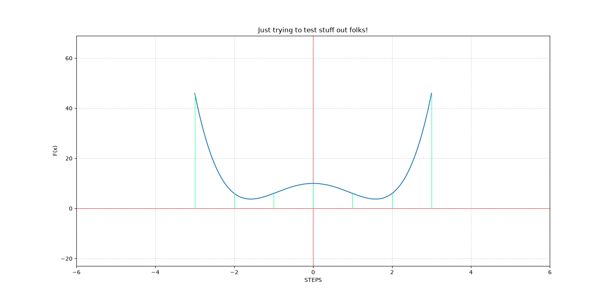
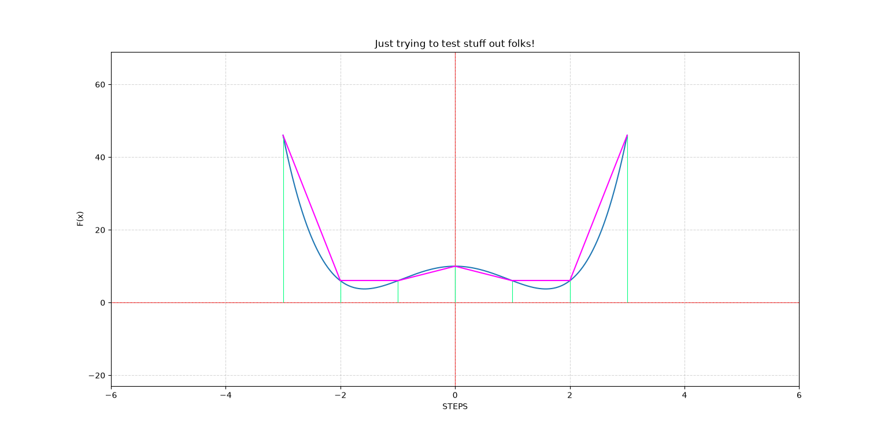
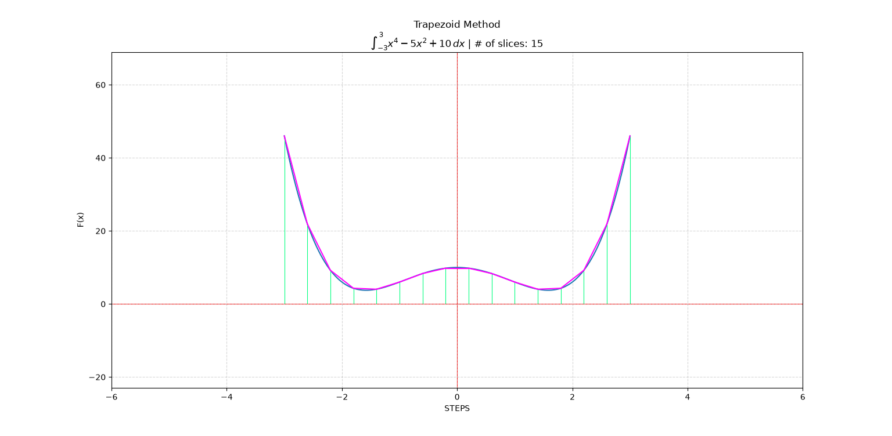
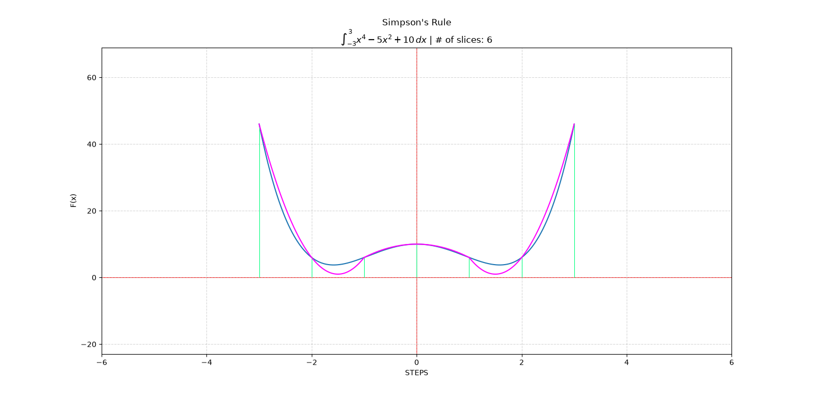
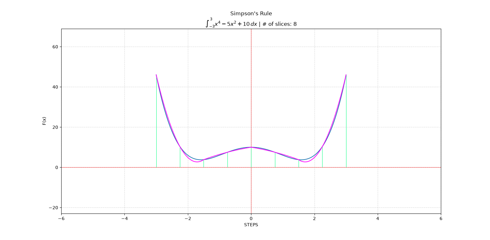
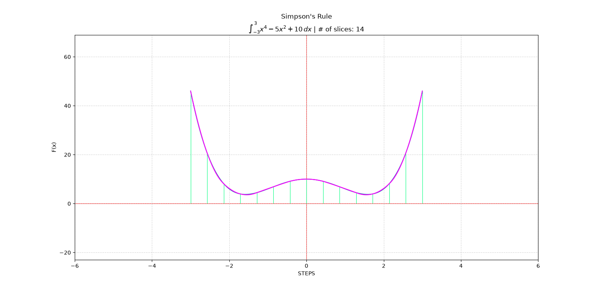

# Numerical-Integration-Analysis

## Goal

The goal is simply to investigate the accuracy of Trapezoidal Method versus Simpson's Rule as both *approach infinity using Numerical/Computational Analysis. There is no set goal results wise, other than being able to discern whether Simpson or Trapezoidal is better through any evaluation method that comes to mind.
- 9/25/26

## Figures

<!-- Add background colours -->

<table border="0">
  <tr>
    <td></td>
    <td></td>
  </tr>
  <tr>
    <td></td>
    <td></td>
  </tr>
</table>

<!-- <h4 align = "Center"> Trapezoid Method <h4>

  

  

  

 -->

<h4 align = "Center"> Simpson's Rule <h4>

<!-- 

  

  

  

 -->

