# Numerical-Integration-Analysis

## Goal

The goal is simply to investigate the accuracy of Trapezoidal Method versus Simpson's Rule as both *approach infinity using Numerical/Computational Analysis. There is no set goal results wise, other than being able to discern whether Simpson or Trapezoidal is better through any evaluation method that comes to mind.
- 9/25/26

## Figures

<!-- Add background colours -->

<h4 align = "Center"> Trapezoid Method <h4>

<table border="0">
  <tr>
    <td>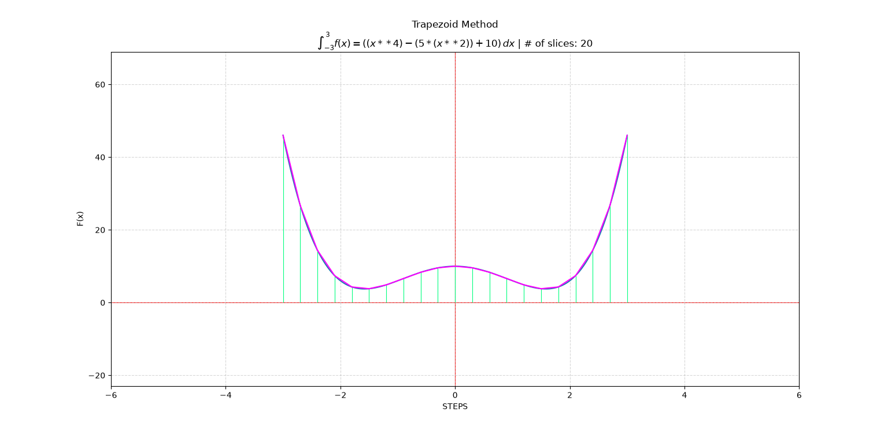</td>
    <td>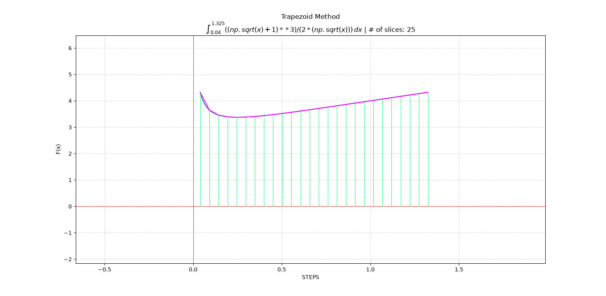</td>
  </tr>
  <tr>
    <td>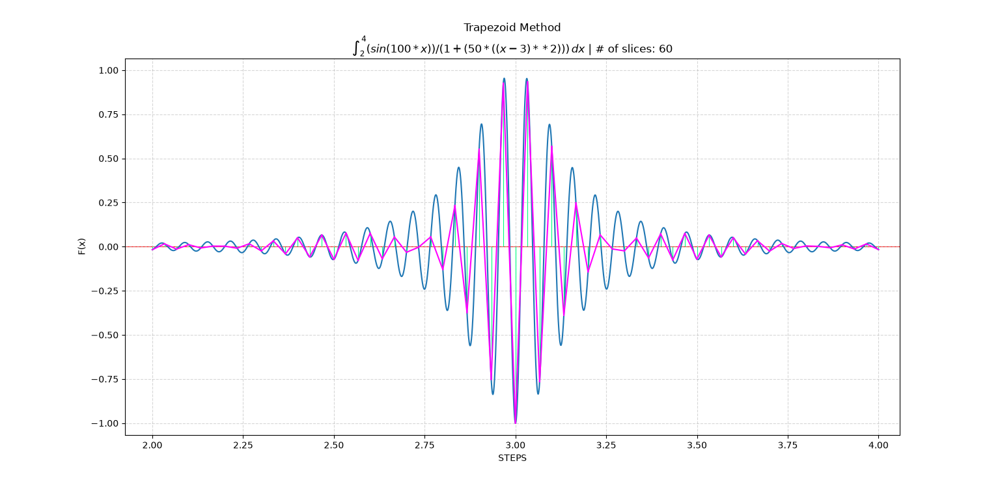</td>
    <td>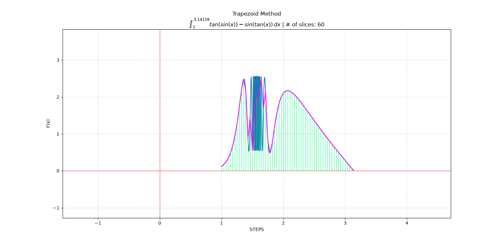</td>
  </tr>
</table>

<h4 align = "Center"> Simpson's Rule <h4>

<table border="0">
  <tr>
    <td>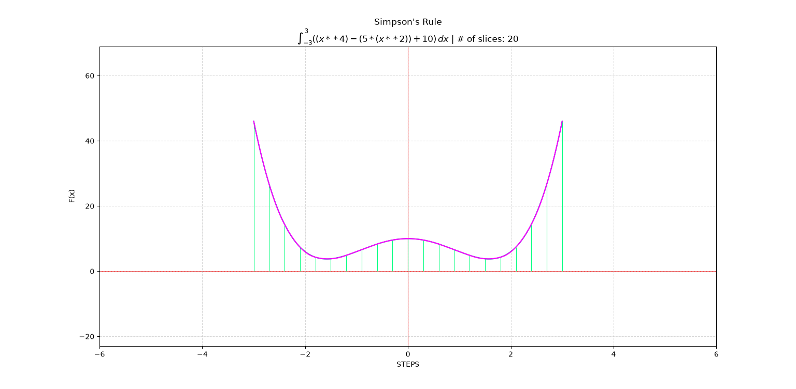</td>
    <td>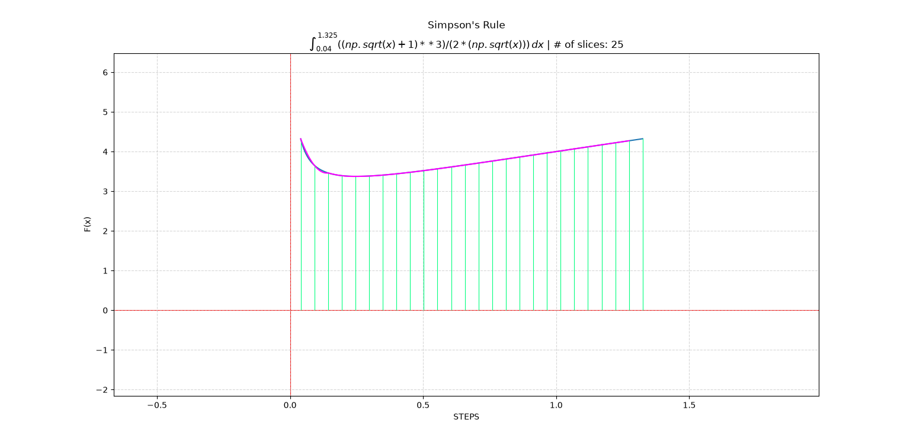</td>
  </tr>
  <tr>
    <td>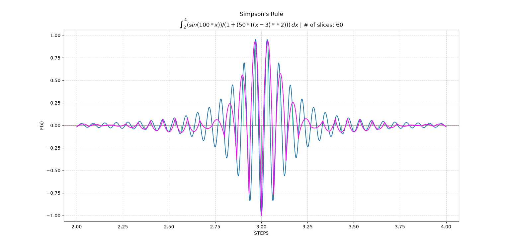</td>
    <td>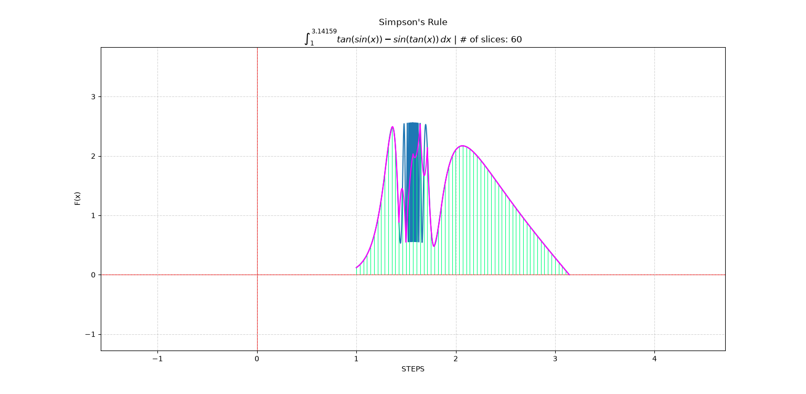</td>
  </tr>
</table>

<h4 align = "Center"> Trapezoid Method & Simpson's Rule Comparison <h4>

<table border="0">
  <tr>
    <td>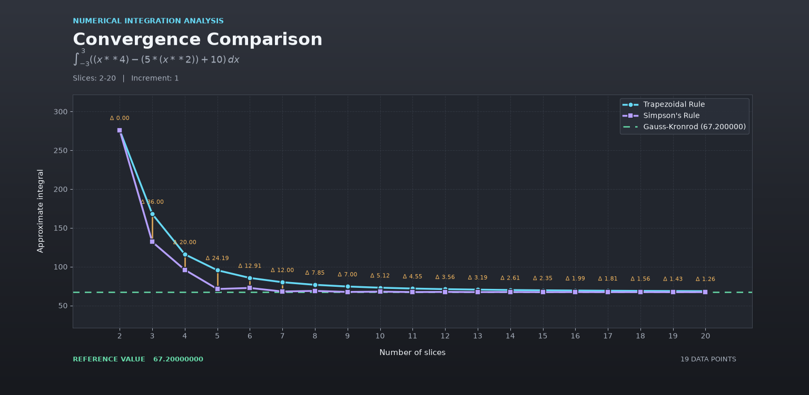</td>
    <td>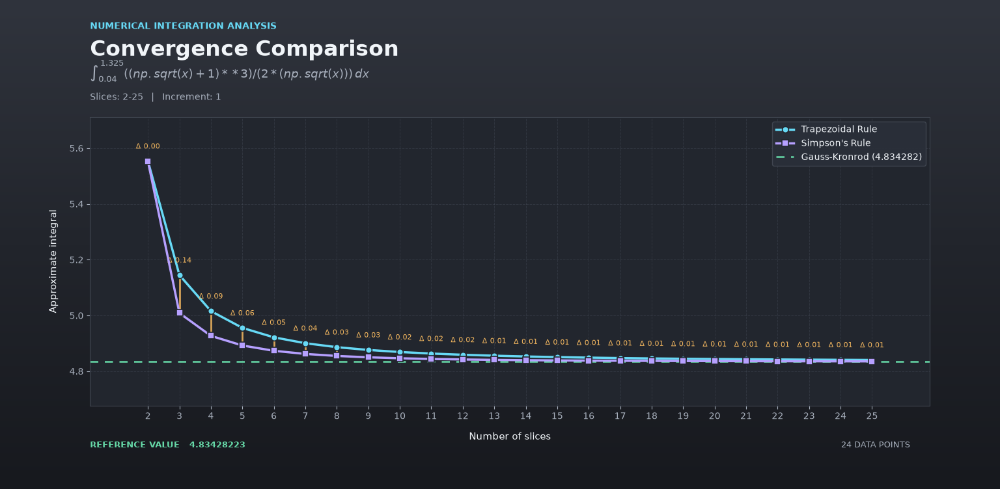</td>
  </tr>
  <tr>
    <td>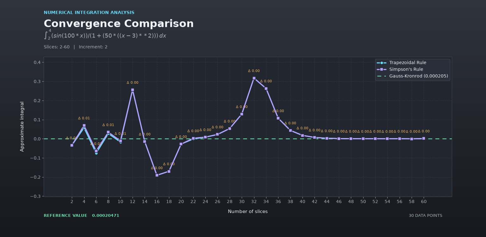</td>
    <td>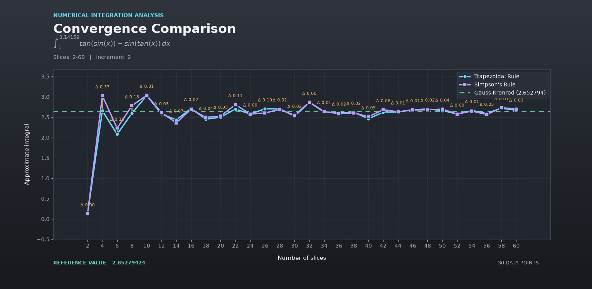</td>
  </tr>
</table>

## How it was done / Structure

<h4 align = "Center"> How it was done / Structure <h4>

How it was done / Structure

->Controlling the number of slices/panels was needed in order to Dynamically feed SciPy's integrate.trapezoid and integrate.simpson functions the parameter used in determining the spacing between the sample points.

->Dynamically controlling the number of slices/panels is important in graphing the comparison between the methods. The reason is because an array/list needs to be created in order to display multiple predetermined amount inputs. Which will then be iterated into each respective SciPy function. 

I knew that since the accuracy of both methods are dependent on the number of slices/panels, increasing them both in parallel would show their respective characteristics.
	Is there a ratios between the 2 values for a slice?

## Results

A graph that displays the difference (delta) between Trapezoidal Method and Simpson's Rule as they approach the actual value for the area under the curve as more "slices/panels" are applied to gain accuracy.
This has shown a noteworthy finding, that for certain functions which exhibit non-standard features/properties (oscillations) is trapezoid better?
	 -The idea came from computing: f(x)=tan(sin(x))-sin(tan(x))
And so could the number of times trapezoid is better tell/mean something?

The Topologist's Sine Wave [f(x) = sin(1/x)] proved to be a hurde for the Comparison portion of the project because as the function's x-input approaches 0, the function's y-output approaches infinity. For that reason . . . 

A modern appearance was overlayed to give a more polished look.
10/26/26

